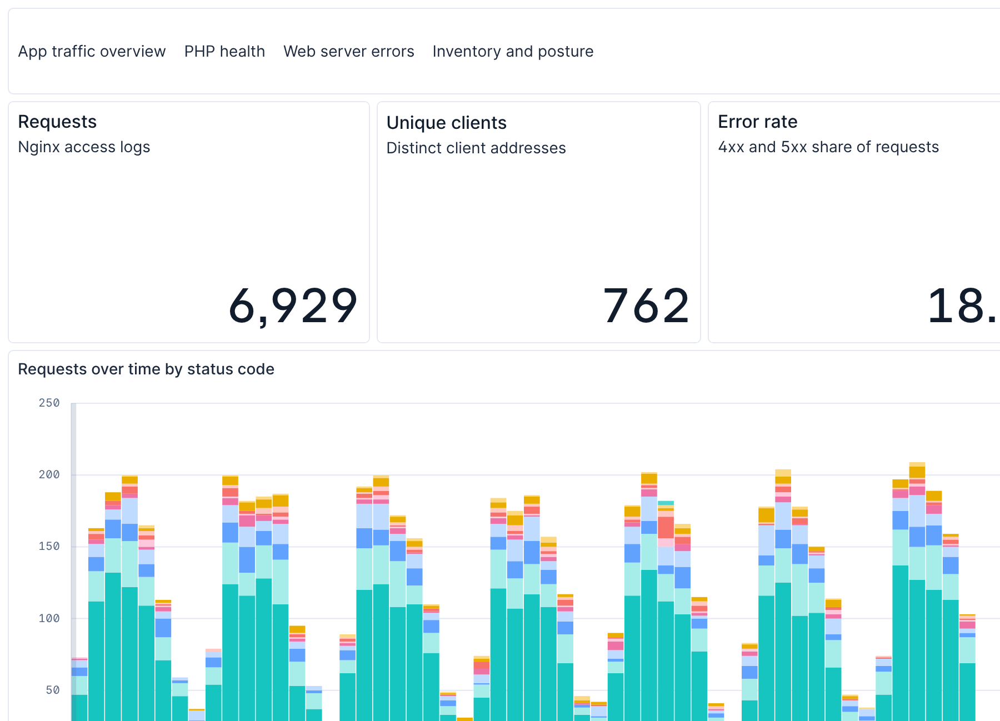
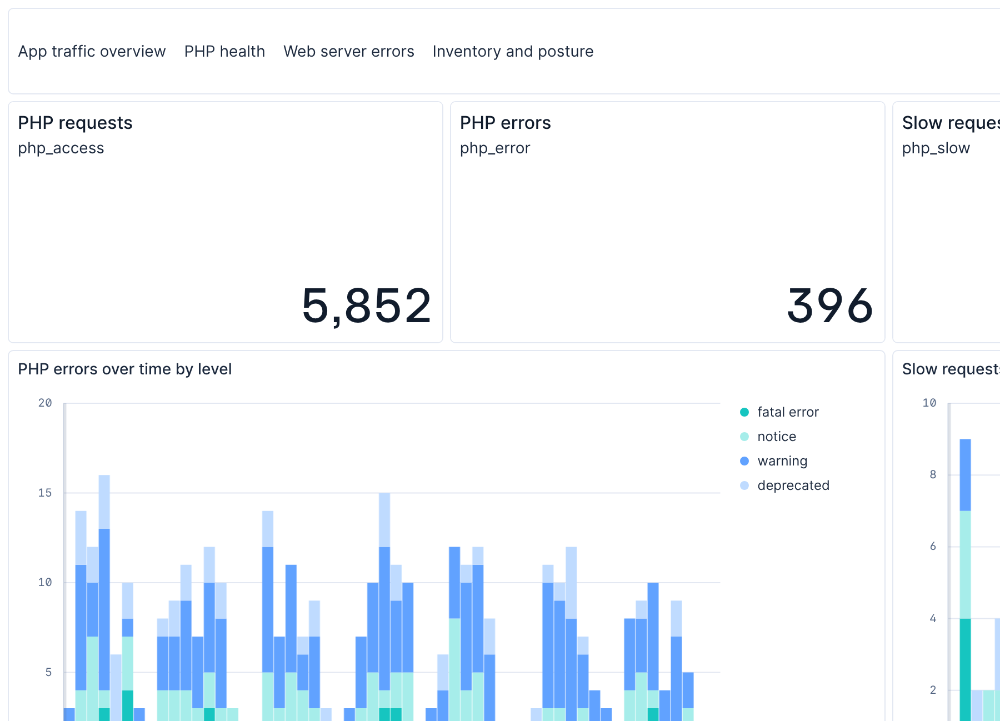

# ServerPilot Integration for Elastic

[](https://github.com/NateShoffner/serverpilot-elastic-integration/actions/workflows/ci.yml)

An Elastic Agent integration that collects the per-app Nginx, Apache and PHP-FPM logs (`nginx_access`, `nginx_error`, `apache_error`, `php_access`, `php_error`, `php_slow`) and the account inventory (`server`, `app`, `database`, `sysuser`) from [ServerPilot](https://serverpilot.io)-managed servers.

The log streams read `/srv/users/SYSUSER/log/APPNAME/` with the filestream input, so every event is tagged with the app and system user that owns it. The inventory streams poll the ServerPilot v1 API with the CEL input. The log formats are validated against a production ServerPilot box; `php_error`, `php_slow` and the API streams against vendor documentation and mocks.

**[Read the integration documentation](packages/serverpilot/docs/README.md)** for setup steps, configuration options, exported fields, and troubleshooting.

## Dashboards

App traffic, PHP health, web server errors, and account inventory and posture, plus a client locations map. Two of the four, shown here with synthetic data:





## Installation

Download the `.zip` from the [latest release](https://github.com/NateShoffner/serverpilot-elastic-integration/releases/latest) and upload it through **Kibana > Integrations > Upload integration**, or:

```sh
elastic-package install --zip serverpilot-<version>.zip
```

To build it yourself instead:

```sh
cd packages/serverpilot
elastic-package build     # writes build/packages/serverpilot-<version>.zip
elastic-package install
```

## Development

Requires [`elastic-package`](https://github.com/elastic/elastic-package) and Docker. Run from `packages/serverpilot`:

```sh
elastic-package check            # lint and build
elastic-package stack up -d -v   # needed by both test commands below
elastic-package test pipeline    # ingest pipeline tests
elastic-package test system      # end-to-end tests against mock services
```

No ServerPilot server is needed: each log data stream ships sample log files under its own `_dev/deploy/docker/`, and the package-level one mocks the management API.

Edit documentation in `_dev/build/docs/README.md`, never in `docs/README.md`, which is regenerated on every build.

### Releasing

Bump `version` in `packages/serverpilot/manifest.yml`, add a matching `changelog.yml` entry, then push a tag:

```sh
git tag v0.2.0 && git push origin v0.2.0
```

CI verifies the tag matches the manifest version, runs the tests, builds the package, and publishes a GitHub release with the `.zip` attached, a build provenance attestation, and notes drawn from the changelog entry.

Both CI and the release run on the shared reusable workflows in [`NateShoffner/elastic-package-workflows`](https://github.com/NateShoffner/elastic-package-workflows).

## License

[Elastic License 2.0](LICENSE).

Not affiliated with ServerPilot or Elastic. ServerPilot is a trademark of ServerPilot, LLC; the package icon is ServerPilot's own logo, used only to identify the product this integrates with.
